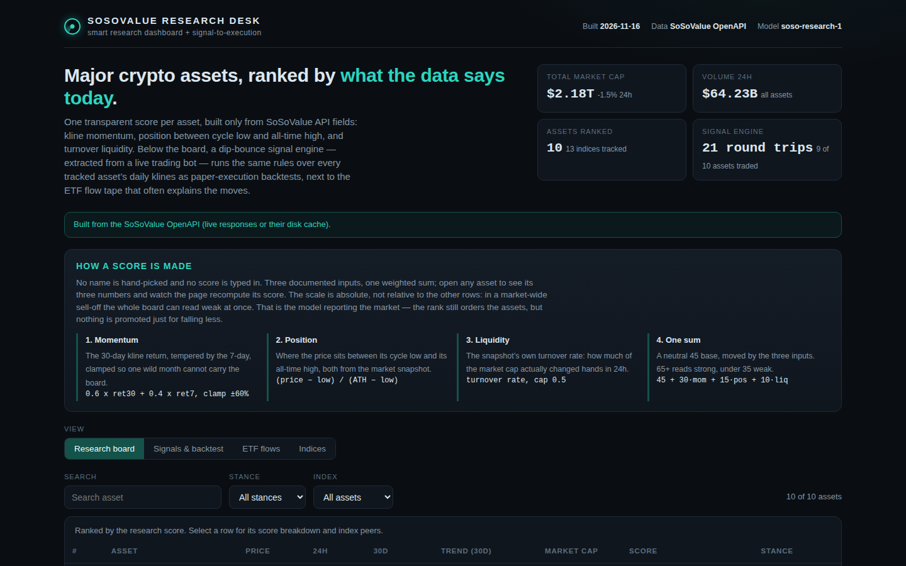
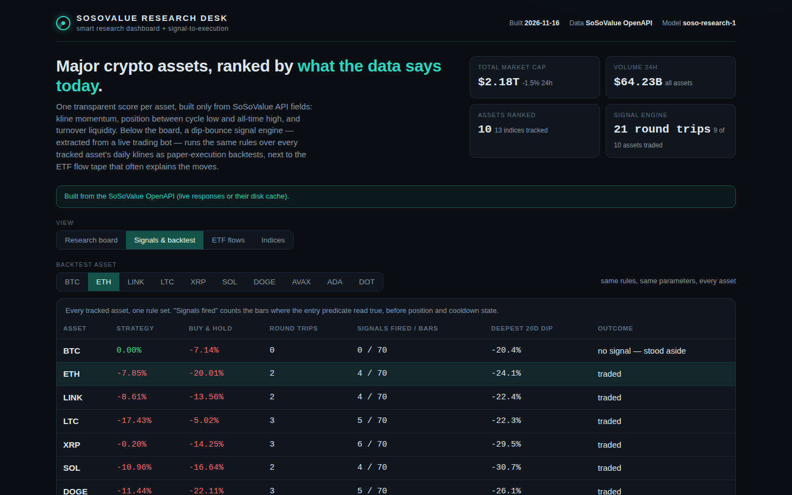
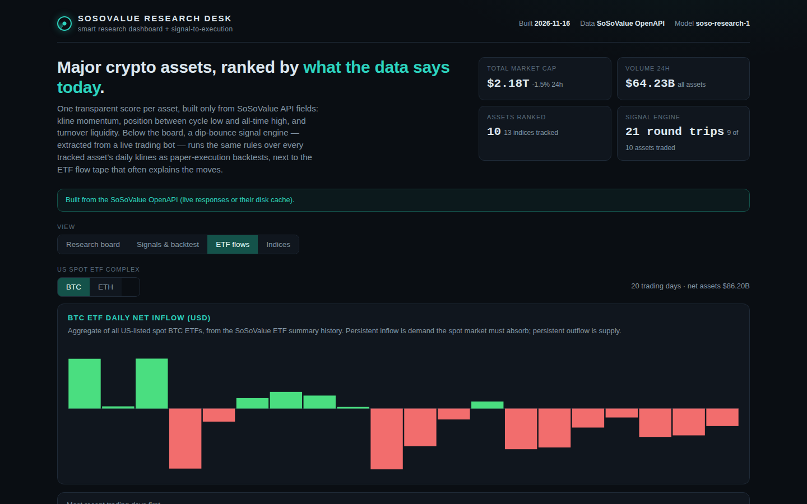
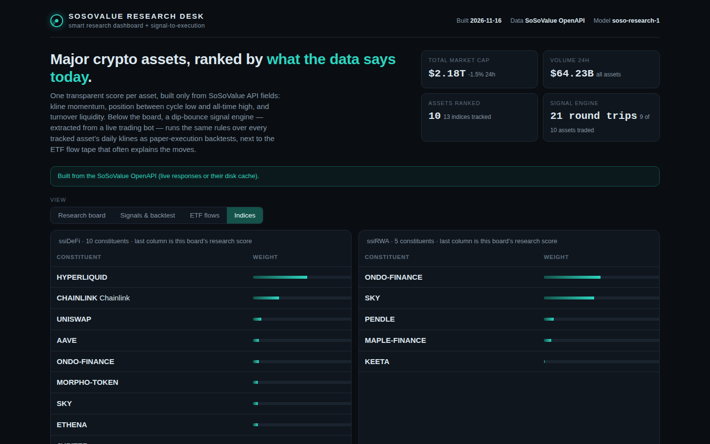

# SoSoValue Research Desk

A **Smart Research Dashboard + Signal-to-Execution** desk built entirely on the
[SoSoValue OpenAPI](https://sosovalue-1.gitbook.io/sosovalue-api-doc). It answers
two questions for a one-person on-chain finance operator:

1. **Where should research time go today?** — a ranked board of major crypto
   assets, each with one transparent score built only from SoSoValue fields.
2. **What would a disciplined signal engine have done?** — a dip-bounce
   strategy (extracted from a live trading bot) replayed over the daily
   klines of *every* tracked asset as paper-execution backtests, next to the
   US ETF flow tape.

The build is a fully static site: one Node command pulls the data, runs the
model and the backtests, and writes a page that renders with no network at all.

## Screenshots

From a live-data build (2026-11-16, a broad market drawdown — see the notes
under *The research score* and *The signal engine* for how to read them):

| Research board | Signals & backtest |
| --- | --- |
|  |  |

| ETF flows | Indices |
| --- | --- |
|  |  |

Regenerate with `node tools/capture.mjs` after a build.

## Features

- **Research board** — 10 major assets ranked by one published formula
  (momentum / position / liquidity), with search, stance and index filters,
  30-day sparklines, and a per-asset detail sheet whose score the page itself
  recomputes from the row's inputs as a self-check.
- **Signal engine, multi-asset** — the same dip-bounce rules and parameters
  replayed over every tracked asset's daily klines: per-asset price chart
  with trade markers, equity curve, full trade list, and strategy vs
  buy-and-hold, drawdown, win rate and exposure.
- **Signal diagnostics** — when an asset produced no trades, the view says
  so and shows the scan behind it: bars evaluated, entry signals fired,
  the deepest dip of the window, and the bar that came closest to
  triggering (with which condition fell short, and by how much). An empty
  trade table is never left to look like a broken page.
- **ETF flows** — daily net inflow / traded value / net assets for the US
  spot BTC and ETH ETF complexes.
- **Indices** — every SoSoValue index with its constituents and weights,
  cross-referenced with the board's research score.
- **Honest data labelling** — every build stamps its data source
  (`live` / `mixed` / `sample`) into the output and the page banner.

## Run it

```sh
# Live data (key from https://sosovalue.com/developer/dashboard):
SOSO_API_KEY=<your key> node main.ts

# Offline / no key yet — runs on the bundled sample snapshot:
node main.ts --offline
```

Then open `dist/dashboard/index.html`. Output in `dist/`:

| File | What it is |
| --- | --- |
| `board.json` | The ranked research board |
| `data.js` | The dashboard's whole dataset (`window.SOSO`) |
| `dashboard/` | The static page (board, signals, ETF flows, indices) |

Requires Node ≥ 22. Standard library only — no dependencies, no build step.

## SoSoValue API integration

Base URL `https://openapi.sosovalue.com/openapi/v1`, header
`x-soso-api-key`. The client (`lib/sosovalue.ts`) unwraps the documented
`{code, message, data}` envelope, spaces live requests to stay under the
documented 20 requests/minute per key, and caches every live response on
disk (`.cache/`, 6h TTL) so repeat builds cost no quota. The signal engine
adds **no** API calls: it reuses the klines the board already fetched.

| Endpoint (docs) | Used for |
| --- | --- |
| `GET /currencies` (1.1) | The tracked-asset universe, matched by symbol |
| `GET /currencies/{id}/market-snapshot` (1.3) | Price, 24h change, market cap, FDV, turnover, ATH / cycle low |
| `GET /currencies/{id}/klines?interval=1d` (1.5) | 7d/30d returns, volatility, sparklines, backtest bars for all 10 assets |
| `GET /etfs/summary-history?symbol=BTC|ETH&country_code=US` (2.1) | Daily net inflow / traded value / net assets tape |
| `GET /indices` (3.1) + `GET /indices/{ticker}/constituents` (3.2) | Index membership and weights per asset |
| `GET /market/overview` (10.1) | Total market cap, 24h volume, gas snapshot |

## The research score

One function scores every asset; the constants are printed on the dashboard
and the page recomputes each row's score from its own inputs as a self-check.

```
momentum  = clamp(0.6·ret30 + 0.4·ret7, −60%, +60%) / 60     (−1..1)
position  = (price − cycle_low) / (ath − cycle_low)          (0..1)
liquidity = clamp(turnover_rate, 0, 0.5) / 0.5               (0..1)
score     = clamp(45 + 30·momentum + 15·(2·position − 1) + 10·liquidity, 0, 100)
```

65+ reads *strong*, 50+ *constructive*, 35+ *neutral*, below that *weak*.

**Read the scale right: it is absolute, not relative.** Every input is the
asset's own returns and position; nothing is normalised against the other
rows, and the stance bands are fixed. In a market-wide drawdown the whole
board can read *weak* at once — on the 2026-11-16 live build all ten assets
did (30-day returns −21% to −35%, prices 49–99% below their all-time highs,
scores 17–24). That is the model reporting the market, not a malfunction:
the rank still orders the assets by the same arithmetic, but no asset is
promoted merely for falling less than its peers. The dashboard states this
beside the board.

It is a research-triage device, not a price target and not investment advice.

## The signal engine

`lib/strategy.ts` is the dip-bounce rule of a bot that previously raced on
1-minute cbBTC bars — buy a sharp sell-off only once it turns up, exit on
take-profit / stop-loss / time-stop, sit out a cooldown — extracted as a pure
function of a bar series, with the harness and wire protocol removed.

One honest adaptation: the SoSoValue API serves **daily klines only** (most
recent 3 months), so the shipped preset (`DAILY_PARAMS`) rescales the race
parameters to daily horizons (20-day lookback, −8% dip, +10%/−5% exits,
20-day max hold). The original 1-minute parameters are preserved in the
source as `RACE_PARAMS_1M` so the change is visible. The backtest fills at
the signal bar's close, charges 15 bps per side, and reports return vs
buy-and-hold, max drawdown, win rate and exposure. It demonstrates the
execution loop; over ~90 bars it does not prove an edge.

**Why some assets show no trades.** The rules are identical for every asset
— no parameter is adjusted per asset or per window. Whether the engine
trades depends on the price path: the entry needs a ≥8% twenty-day sell-off
*and* a turn up within the last 3 days. In the one-way drawdown of the
2026-11-16 live build, nine of ten assets traded (21 round trips in total)
while BTC never saw its bounce: over 70 evaluable bars the entry predicate
fired 0 times, the deepest 20-day dip (−20.4%) was the final bar with the
3-day turn still at −5.75%, and the closest miss (2026-11-09, dip −9.2%)
fell 0.83 points short on the turn. The signals view shows exactly this
scan for every quiet asset. Retuning the rule to manufacture BTC trades
would be curve-fitting the demo, so the desk reports the stand-aside
instead — capital preserved at 0.00% while buy-and-hold lost 7.14%.

## Sample data — read this before quoting any number

With no `SOSO_API_KEY` set (or with `--offline` and a cold cache), the
client falls back to `data/sample.json` so the whole pipeline runs end to
end. That file is **synthetic**: generated deterministically by
`tools/make-sample.mjs` (seeded PRNG), with payload *shapes* mirroring the
documented API responses and invented values. The dashboard banner and
`board.json`'s build metadata state the data source (`live` / `mixed` /
`sample`) on every build. Set a key and rebuild for live data — no code
changes.

## Layout

```
main.ts               pipeline: gather → board + backtests → static site
lib/sosovalue.ts      API client: cache, rate-limit spacing, sample fallback
lib/model.ts          research score + board builder + data.js writer
lib/strategy.ts       dip-bounce strategy core + backtest driver + signal diagnostics
dashboard/            the static page (four views)
data/sample.json      synthetic fallback snapshot (see above)
tools/make-sample.mjs regenerates data/sample.json
tools/capture.mjs     screenshots of the four views into docs/
docs/                 screenshots from a live-data build
```

## Status

Built for the AKINDO × SoSoValue WaveHack (Wave 3, submission deadline
2026-11-27). Live integration verified end to end on the free developer
tier; see `CHANGELOG-wave3.md` for the wave's progress log and
`BUILDLOG.md` for the engineering record.
